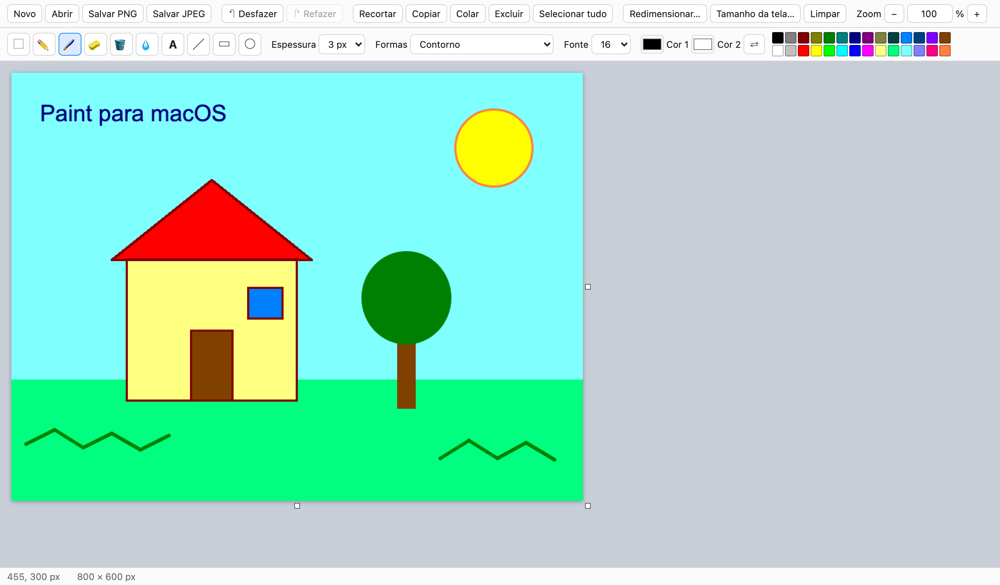

# paint_for_mac

Ferramenta simples de edição de imagem, no estilo do Paint do Windows, para o macOS.
Roda no navegador: **sem instalação, sem loja e sem build.**

## Como usar

**Jeito mais fácil:** pegue só o arquivo [`dist/paint.html`](dist/paint.html) e dê duplo clique. Ele abre no Safari ou no Chrome. É o app inteiro num arquivo de cerca de 60 KB, então dá para mandar por AirDrop, e-mail ou pendrive.

Ou, com a pasta completa (para desenvolver): dê duplo clique em `index.html`.

## Funcionalidades

- **Ferramentas:** seleção, lápis, pincel, borracha, balde de tinta, conta-gotas, texto, linha, retângulo e elipse.
- **Cores:** cor 1 no clique esquerdo e cor 2 no clique direito (ou Ctrl+clique). Inclui a paleta clássica de 28 cores.
- **Desfazer/refazer:** até 30 passos.
- **Área de transferência:** copiar, recortar, colar (inclusive prints do macOS) e excluir.
- **Arquivo:** abrir imagem, salvar em PNG ou JPEG e mudar o tamanho da tela, pelo menu ou **arrastando as alças** no canto inferior direito, na borda direita ou na borda de baixo da imagem (Shift no canto mantém a proporção).
- **Redimensionar:** escala a imagem por porcentagem ou pixels. Com "Manter proporção", basta informar uma dimensão e a outra é calculada.
- **Exibição:** zoom de 10% a 1600%. Dá para digitar o valor, usar os botões −/+, ⌘−/⌘+/⌘0 ou a pinça do trackpad.

## Atalhos

| Ação | Atalho |
|---|---|
| Desfazer / Refazer | ⌘Z / ⇧⌘Z |
| Salvar PNG | ⌘S |
| Abrir | ⌘O |
| Copiar / Recortar / Colar | ⌘C / ⌘X / ⌘V |
| Selecionar tudo | ⌘A |
| Zoom − / + / 100% | ⌘− / ⌘+ / ⌘0 |
| Excluir seleção | Delete |
| Confirmar texto/seleção | Esc |
| Trocar cor 1 ↔ cor 2 | X |
| Ferramentas | S seleção, P lápis, B pincel, E borracha, F balde, I conta-gotas, T texto, L linha, R retângulo, O elipse |
| Forma perfeita / linha a 45° | segurar Shift |

## Para desenvolvedores

As decisões de arquitetura, o mapa de arquivos e o guia para adicionar ferramentas estão em [`CLAUDE.md`](CLAUDE.md).
Cada pasta tem um README descrevendo seus arquivos: [`js/`](js/README.md), [`js/tools/`](js/tools/README.md), [`css/`](css/README.md), [`tests/`](tests/README.md), [`docs/`](docs/README.md), [`scripts/`](scripts/README.md) e [`dist/`](dist/README.md).
Para gerar o arquivo único, rode `node scripts/build.mjs`.
Para o teste automático, rode `node tests/e2e.mjs` (requer Node 22+ e Google Chrome).
